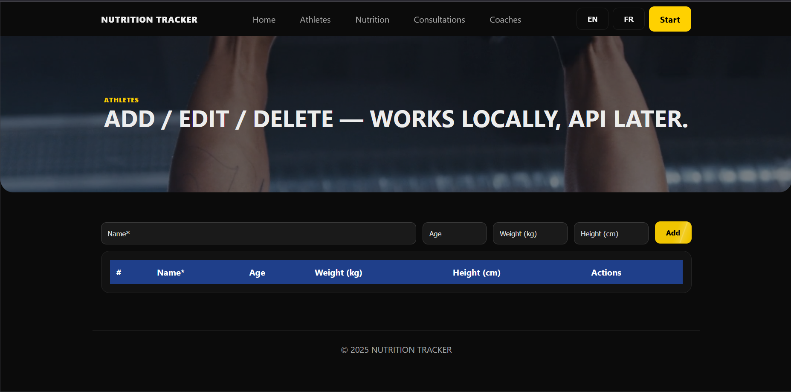
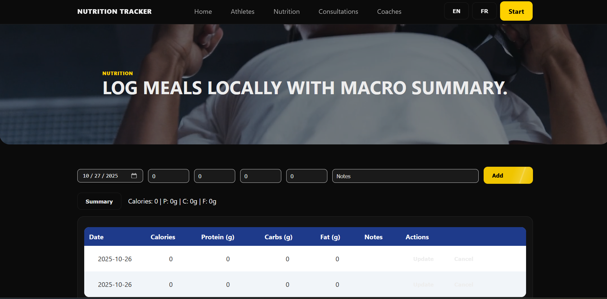

# 🥗 Olympic Nutrition Tracker

A modern web application built with **Angular 17** and **Spring Boot** for managing athletes, nutrition monitoring, consultations, and coach administration.

The application includes a role-based authentication system with different permissions for administrators, coaches, and athletes.

---

# 🌍 Features

- 🔐 Authentication (Sign In / Sign Out)
- 👤 Role-Based Access Control (ADMIN, COACH, ATHLETE)
- 🧍 Athlete Management
- 🧑‍🏫 Coach Management
- 🍽️ Nutrition Tracking
- 📅 Consultation Management
- 🌐 Multilingual Interface (English / French)
- 🎥 Modern UI with video hero sections
- 📱 Responsive Design

---

# 🔐 Demo Accounts

| Username | Password | Role |
|----------|----------|------|
| admin | admin123 | ADMIN |
| coach01 | 123456 | COACH |
| athlete01 | 123456 | ATHLETE |

---

# 👥 Permissions

### ADMIN
- Full access to the application
- Manage athletes
- Manage coaches
- Manage nutrition entries
- Manage consultations

### COACH
- View athletes
- Manage nutrition entries
- Manage consultations
- Read-only access to coaches

### ATHLETE
- View athletes
- View nutrition data
- View consultations
- Read-only access to the application

---

# 🖼️ Screenshots

### 🏠 Home Page


### 🔐 Sign In


### 🧍 Athletes



### 🍽️ Nutrition



---

# ⚙️ Technologies

| Category | Technologies |
|-----------|--------------|
| Frontend | Angular 17, TypeScript |
| UI | HTML5, CSS3, Bootstrap |
| Backend | Spring Boot (Java 21) |
| Database | MySQL |
| Security | Spring Security (HTTP Basic) |
| Version Control | Git & GitHub |
| Tools | IntelliJ IDEA, VS Code, Postman |

---

# 🚀 Installation

Clone the repository

```bash
git clone https://github.com/eman-java-dev/olympic-nutrition-tracker-frontend.git
```

Go to the project

```bash
cd olympic-nutrition-tracker-frontend
```

Install dependencies

```bash
npm install
```

Run the application

```bash
ng serve -o
```

The application runs at

```
http://localhost:4200
```

---

# 🌐 Languages

- 🇬🇧 English
- 🇫🇷 Français

---

# 🔒 Security

The current version uses:

- Spring Security
- HTTP Basic Authentication
- Role-Based Access Control (ADMIN / COACH / ATHLETE)

JWT authentication and database user management are planned for a future version.

---

# 📌 Future Improvements

- JWT Authentication
- User Registration
- Password Encryption
- User Profile
- Cloud Deployment
- Unit & Integration Tests

---

# 👩‍💻 Author

**Eman Altohami**

Bachelor Java Developer – Studi

GitHub:
https://github.com/eman-java-dev